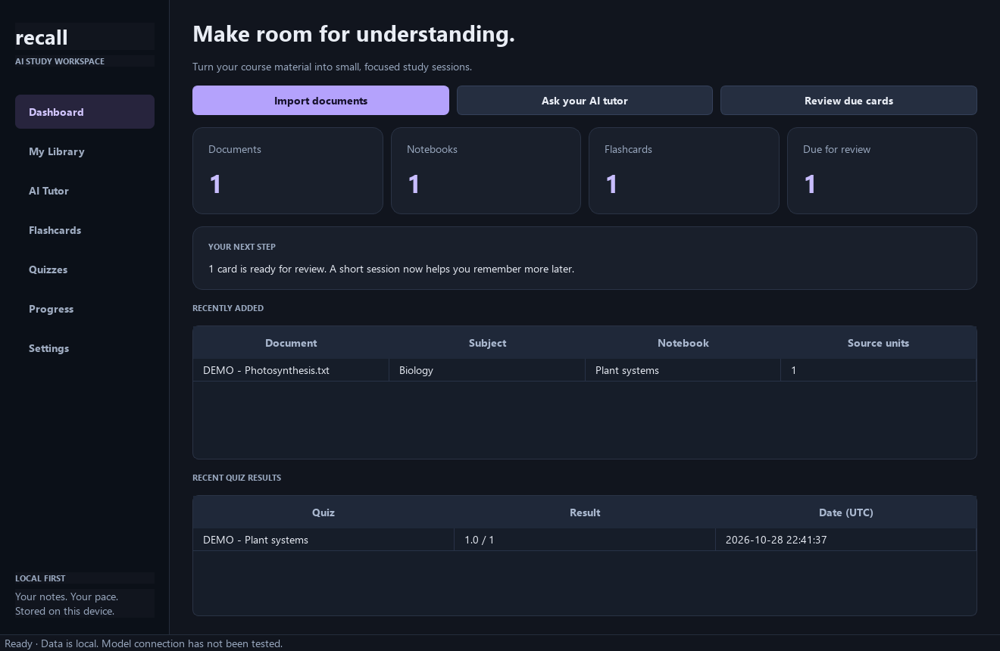
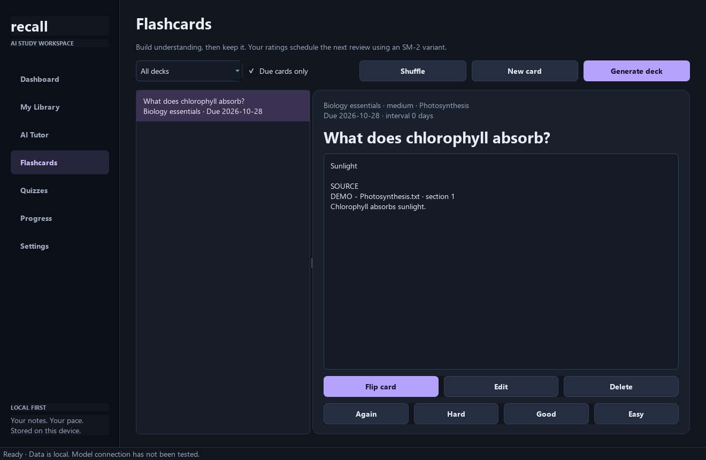

# Recall AI

A local-first Windows desktop study workspace. Turn your course documents into source-cited explanations, editable flashcards, spaced reviews and practice quizzes. No paid AI account is required. Documents and history stay on your device unless you explicitly enable an external inference endpoint.



*Screenshots use isolated, explicitly labeled synthetic demo data. The application starts with an empty library and real statistics.*

## Quick start — Windows 11

Install **Python 3.11** (64-bit, recommended; 3.12/3.13 supported by the setup check) and Git if cloning. Python 3.11.17 is the verified runtime. Python 3.15 is not a supported runtime for this pinned dependency set.

```powershell
git clone https://github.com/Abyxen/recall-ai-desktop.git
cd recall-ai-desktop
.\setup.bat
.\run.bat
```

Setup creates `.venv` and installs the complete pinned development dependency set. If Python discovery fails:

```powershell
powershell -NoProfile -ExecutionPolicy Bypass -File setup.ps1 -Python C:\Path\To\Python311\python.exe
```

For an existing environment, install `requirements.txt` for runtime only or `requirements-lock.txt` for the verified full set. Launch directly with `.\.venv\Scripts\python.exe -m recall`.

The app launches without Ollama. Importing, searching previews, editing/reviewing saved cards, taking saved quizzes and viewing progress work without inference. Tutor retrieval shows evidence with an unavailable-model notice when inference fails. Generating new material requires a model.

## Connect a local model

Install [Ollama](https://ollama.com), start it, and run `ollama list`. In **Settings**, use provider `ollama`, endpoint `http://localhost:11434`, and select an installed instruct model using **Test connection / list models**. Save after changing the selection.

The developer machine was tested with its existing custom `axom:latest` model; that name is not a public dependency and is not bundled. A practical optional starting point is [qwen3:4b](https://ollama.com/library/qwen3:4b), listed at about 2.5 GB; this is a hardware-sizing recommendation, not a benchmark of that model in Recall. Download it manually only if wanted: `ollama pull qwen3:4b`.

For semantic retrieval, manually install [qwen3-embedding:0.6b](https://ollama.com/library/qwen3-embedding:0.6b), set **Embedding model** to that name and re-index any existing documents. This model was installed with explicit user consent and verified on the developer laptop. Leave this field empty to use the offline lexical vector fallback, which does not require model downloads. Recall never downloads models automatically. See [model setup](docs/MODEL_SETUP.md).

## Study workflow

1. **My Library:** import or drop PDF, DOCX, PPTX, UTF-8/UTF-16 TXT or Markdown. Choose a subject and notebook. Organize, preview, re-index or remove records. Duplicate contents are rejected. Original files are never modified; managed copies are retained on removal.
2. **AI Tutor:** choose a document, notebook, subject or entire library. Ask a question at beginner, standard or advanced level. Select explanations, summaries, examples, comparisons, concepts or revision notes. Source excerpts appear beside the response. Conversation history is scoped and saved.
3. **Flashcards:** generate 1–20 cards for a scope, topic or exact passage. Review their accuracy against the attached quotes. Edit cards and move them between decks; flip, shuffle and rate Again / Hard / Good / Easy. Use the due-only filter for scheduled reviews. Manual cards also work offline.
4. **Quizzes:** generate mixed or single-type questions. Choose difficulty and count; optionally set a time limit before starting. Submit, inspect corrections and source quotes, review saved attempts and retake quizzes.
5. **Dashboard / Progress:** view actual documents, notebooks, cards, due reviews, recent results, seven-day activity and weak topics. A study action is one card rating or one submitted quiz.

Shortcuts: **Ctrl+O** import, **Ctrl+Enter** ask (Tutor page), **Ctrl+1/2/3** Dashboard/Library/Tutor.



## Data and privacy

Default storage is `%LOCALAPPDATA%\RecallAI`: `recall.sqlite3` plus managed library copies. Override with the `RECALL_DATA_DIR` environment variable before launch. **Settings → Library directory** changes the destination for future imports; it does not move existing copies. Back up the entire data directory and any custom library directory while the app is closed. Local files are not encrypted.

SQLite stores extracted chunks and normalized embedding vectors as the persistent index. No cloud database, telemetry, automatic model downloads or document uploads. Non-loopback endpoints (including LAN servers) require the explicit external-data checkbox. Keys are read only from `RECALL_API_KEY`, never stored by the app. HTTP redirects are blocked. Imported content and generated code are never executed.

## Tests and executable

```powershell
.\.venv\Scripts\python.exe -m pytest -q
# Opt-in live integration; uses installed models and synthetic temporary documents:
.\.venv\Scripts\python.exe tools\live_smoke.py --model axom:latest --embedding-model qwen3-embedding:0.6b
# Substitute your installed chat model above.
powershell -NoProfile -ExecutionPolicy Bypass -File build.ps1
```

Build output is `dist\RecallAI\RecallAI.exe`. Distribute the **entire RecallAI folder**. Model weights, user documents and databases are not bundled. The build is unsigned. See [testing](docs/TESTING.md) for verified results and [troubleshooting](docs/TROUBLESHOOTING.md).

## Practical limits

- AI can make factual mistakes. Matching source quotes and valid citation IDs do not prove that the generated claim follows from them. Verify the displayed excerpts.
- Free-text grading uses transparent rubric-phrase coverage and is **provisional**; it does not understand paraphrases, negation or reasoning reliably. It is not an exam-grade evaluator. Calculation checking compares a decimal answer within 0.1%; it does not verify the generated mathematics or units.
- DOCX is cited by section, not invented rendered page numbers. PPTX uses slides; PDF uses actual pages; plain text uses form-feed sections.
- Image OCR needs optional Tesseract on PATH. Scanned-PDF OCR additionally needs optional PyMuPDF. These were not installed or verified in this environment. Text extraction does not read equations embedded as images.
- Limits: 50 MB input, 1,000 PDF pages, 2 million extracted characters, 200 MB expanded Office archive, 40 megapixel image. Generation uses up to 14,000 characters of selected evidence; whole-library generation begins with early chunks. Topic search or document scoping improves coverage.
- Exact cosine search is intended for personal libraries. Retrieval thresholds are heuristic. No reranker, streaming responses, light theme, cloud sync or signed installer yet.

More: [architecture](docs/ARCHITECTURE.md), [development log](docs/DEVELOPMENT_LOG.md), [roadmap](docs/ROADMAP.md). Source is MIT licensed; bundled dependencies retain their own licenses, including PySide6/Qt's LGPL/commercial terms. Review third-party obligations before distributing a modified executable.
